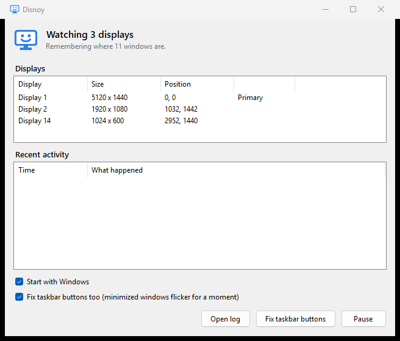

# Disnoy

**Display un-annoy.** A small Windows tray app that puts your windows back where they were when a display drops out and comes back.



## The problem

Some monitors, especially large DisplayPort ones, disconnect completely when they go to sleep and take a couple of seconds to reconnect when they wake up. To Windows that looks like the monitor was unplugged, so it:

1. moves every window off the missing display, and often makes another display the primary one for a moment,
2. moves most of them back when the display returns, but gets some wrong. Windows that were on a *different* display can end up on the one that came back, sometimes maximized,
3. leaves taskbar buttons on the wrong taskbar, so a window on one display has its button on another.

Windows has a feature meant to prevent this (Rapid Hot Plug Detection), but it depends on the graphics driver and often doesn't kick in.

## What Disnoy does

- While all your displays are connected, it remembers where every window is, once a second.
- When a display drops out, it stops updating and holds on to that layout.
- When the same arrangement of displays is back, it waits for Windows to finish shuffling, then puts every window back, including whether it was minimized or maximized. It doesn't bring windows to the front.
- Optionally, it fixes taskbar buttons by briefly showing each minimized window it moved and minimizing it again. That's the only reliable way to make Explorer move a button to the right taskbar, so those windows flicker for a moment.
- If a display stays gone for 2 minutes while the screens are on, Disnoy assumes you unplugged it on purpose and stops waiting for it.

The tray icon is blue while it's watching, orange while a display is missing, and gray when paused.

## Install

1. Download `Disnoy.exe` from the [latest release](../../releases/latest).
2. Put it somewhere permanent, for example `%LOCALAPPDATA%\Programs\Disnoy`, and run it.

On first run it opens its window and turns on **Start with Windows**. Closing the window keeps it running in the tray. Use **Exit** in the tray menu to quit.

It needs Windows 10 or 11. It runs on .NET Framework 4.8, which is built into Windows, so there's nothing else to install. It doesn't need admin rights.

## Where things are kept

- Log: `%LOCALAPPDATA%\Disnoy\disnoy.log` (rotated at 2 MB). It records display changes, lock and unlock, screens turning off and on, and every window that moves between displays, which helps when figuring out what your monitors are doing.
- Settings: `HKEY_CURRENT_USER\Software\Disnoy`
- Start with Windows: the `Disnoy` value under `HKEY_CURRENT_USER\Software\Microsoft\Windows\CurrentVersion\Run`

To uninstall, untick **Start with Windows**, exit, and delete the exe and those two locations.

## Build

```
dotnet build src/Disnoy -c Release
```

The output is `src/Disnoy/bin/Release/net48/Disnoy.exe`. The app icon is drawn in code (`AppIcon.cs`). After changing it, regenerate `Disnoy.ico` with:

```
src\Disnoy\bin\Release\net48\Disnoy.exe --write-icon src\Disnoy\Disnoy.ico
```

## Limitations

- Disnoy restores windows that were open before the display dropped out. It has nothing to go on for windows opened while a display was missing.
- Windows of apps running as administrator can't be moved by a non-admin app, so those are skipped.
- If you rearrange your displays in Settings, Disnoy treats the new arrangement as the one to remember.

## License

MIT
